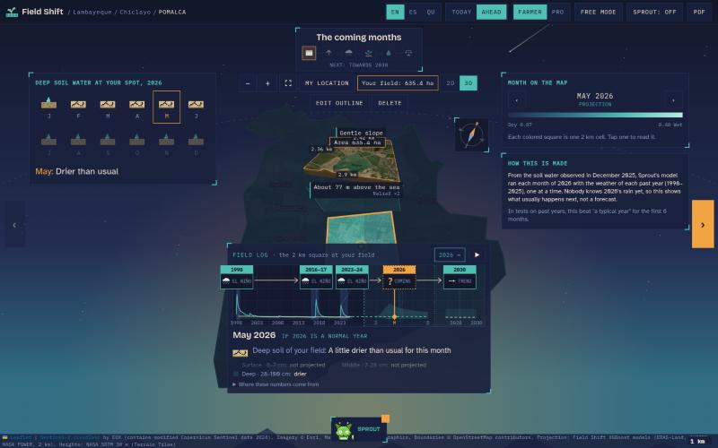
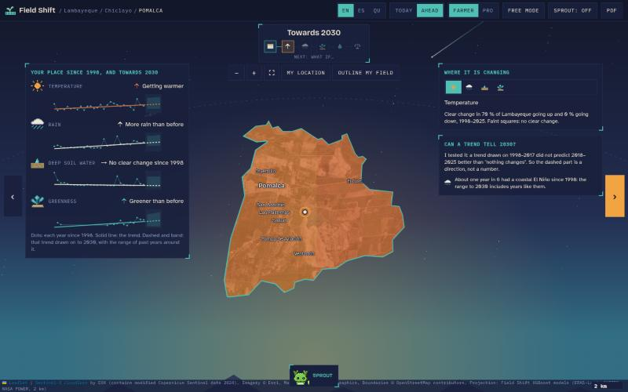
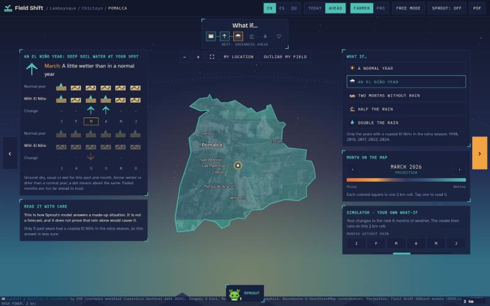
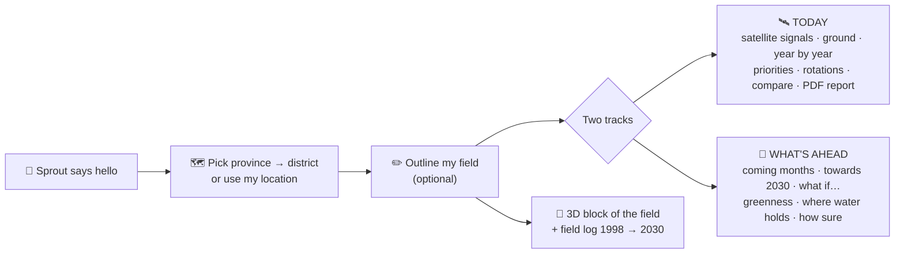
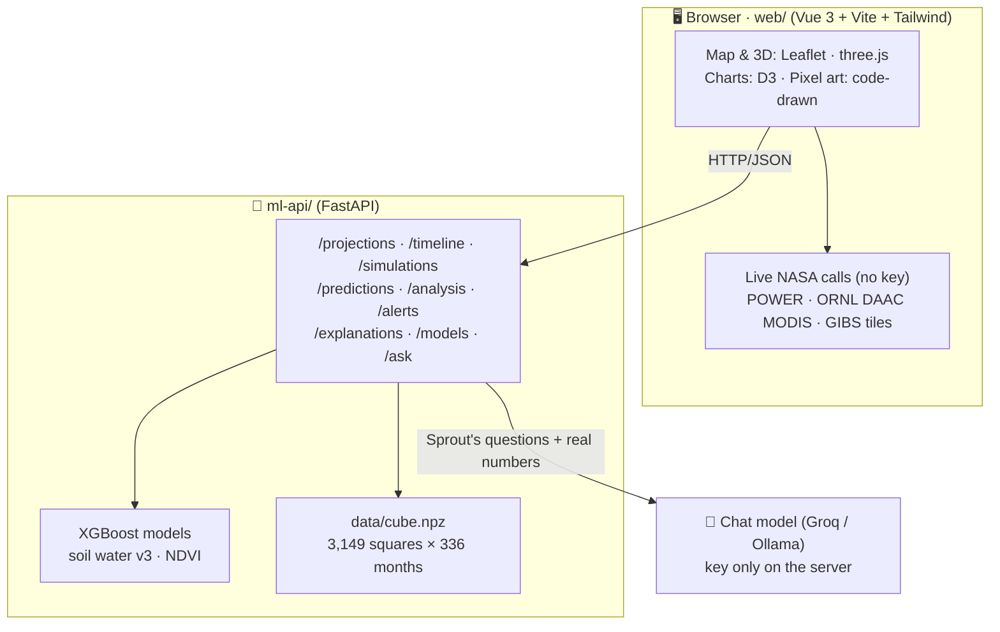
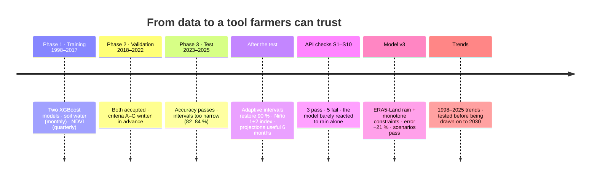
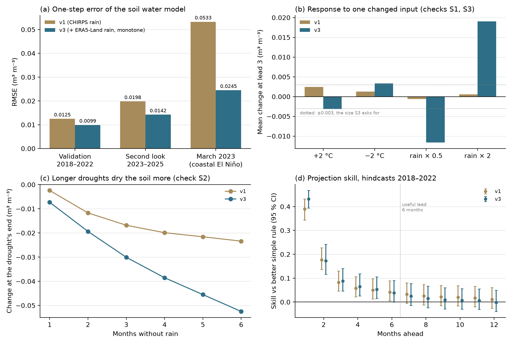

<div align="center">

# 🌱 Field Shift

### *Your field is already talking. Let's learn to listen.*

**NASA Space Apps Challenge 2026 · Challenge: _Field Shift: Adapting Farms with NASA Data_**
**Cat Space Team · Chiclayo, Lambayeque, Peru** 🇵🇪

[](https://www.spaceappschallenge.org/)
[](web/)
[](ml-api/)
[](ml/)
[](docs/LANGUAGES.md)

[🎬 **Demo**](#-project-demo) · [🌍 **Summary**](#-high-level-project-summary) · [🧭 **What it does**](#-what-it-does) · [⚙️ **How it works**](#%EF%B8%8F-how-it-works) · [🛰️ **NASA data**](#%EF%B8%8F-nasa-data) · [🤖 **Use of AI**](#-use-of-ai-super-intelligence) · [🚀 **Run & deploy**](#-run-it-locally)

</div>

---

## 🔗 Links for the judges

| | |
|---|---|
| 🌐 **Live app** | ✏️ *add the public URL after deploying (see [Deploy](#%EF%B8%8F-deploy-on-a-virtual-machine))* |
| 🎬 **Project demo** (≤ 30 s video, English subtitles) | ✏️ *add the YouTube / Google Drive link* |
| 📄 **Research paper** (PDF, 21 pages) | [`web/public/paper/field_shift_ml.pdf`](web/public/paper/field_shift_ml.pdf) · LaTeX source in [`paper/`](paper/) |
| 💻 **Source code** | this repository (everything needed to run it is here, see [Run it locally](#-run-it-locally)) |
| 📚 **Model reports** | [`docs/ML_CAPABILITIES.md`](docs/ML_CAPABILITIES.md) → phases, checks, v3, trends |

> All links are public: no login, password or permission needed.

---

## 🌍 High-level project summary

Farmers on the dry north coast of Peru plan their crops between a desert climate, irrigation valleys and the sudden rains
of the **coastal El Niño** (1998, 2017, 2023 flooded fields and greened the desert). The data that could help them,
NASA's Earth observations, exist, but they arrive as files, grids and acronyms.

**Field Shift** is a web tool that turns NASA Earth data into **plain language and pictures a farmer understands**. You
pick your district (or outline your own field), and a small alien-cat guide, **Sprout**, walks you through:

- 🛰️ **Today:** what the satellites see over your land: heat, rain, soil moisture, greenness, terrain, groundwater, in
  every month of a typical year and of El Niño years, and how example crop rotations fit that climate.
- 🔮 **What's ahead:** what our **machine-learning models** (XGBoost, trained and tested on 28 years of data for 3,149
  squares of 2 km) expect for the deep soil water and the greenness of your square in the coming months; "what if" an
  El Niño comes, two months without rain, half or double the rain; where in Lambayeque water holds best; how your place
  has changed since 1998 and where that points towards 2030, and **how sure the models really are**.

**Why it matters:** decisions like *what to sow, when, and how much water to keep* are made months ahead, with little
information. Field Shift gives a farmer the same evidence a scientist would look at, honestly labelled: every number says
where it comes from, how big its pixel is, and how often the model was right on past years.

---

## 🎬 Project demo

✏️ *Add the demo link here (≤ 30 s video with English subtitles, or ≤ 7 slides in English).*

<div align="center">

| 🛰️ The field in 3D and its log, 1998 → 2030 | 📈 Towards 2030: how your place changed |
|---|---|
|  |  |
| **🌦️ What if… (model scenarios)** | **🐱 Sprout, the guide (10 moods)** |
|  |  |

</div>

---

## 🧭 What it does



| | Feature | What the farmer sees |
|---|---|---|
| 🗺️ | **Clipped satellite map** | Lambayeque cut to the chosen district, with town names; NASA GIBS layers on top |
| 🛰️ | **Satellite signals** | Heat, rain, soil moisture, greenness and groundwater as *pixel instruments* (thermometer, rain gauge, a plant that is fine, thirsty or dead) |
| 📅 | **Year by year** | Warming stripes since 1981 and the wettest and driest years |
| 🌾 | **Crop rotations** | A year read as a furrow of 12 plants; fit to the place's climate (scores are labelled *hypothetical*) |
| 🔮 | **The coming months** | Deep soil water (28–100 cm) of the 2 km square, month by month, with the 90 % range |
| 📈 | **Towards 2030** | 1998–2025 trends of temperature, rain, deep soil water and greenness, drawn on to 2030 as a *direction* |
| 🌦️ | **What if…** | El Niño years, two dry months, half or double the rain, your own changes (dry months, ±°C, rain) |
| 💧 | **Where water holds** | Districts and towns ranked by the deep soil water expected in the dry season |
| 🧊 | **3D field + field log** | The outlined field rises as a block of land over the real relief; its soil layers fill with water as you drag a ship-log-style timeline from 1998 to 2030 |
| ⚖️ | **How sure is Sprout** | Skill by month ahead, the real coverage of the ranges, what changed with the newest model, what Sprout cannot tell you |
| 🐱 | **Sprout** | Explains each screen once; answers open questions with an AI that only interprets numbers computed by the models |
| 🎙️ | **Talk to Sprout** | Voice in Spanish or English with a soft kitten voice; "take me to Olmos" or "show me how sure you are" moves the map and opens the screen ([how](ml-api/README.md#sprouts-voice-assistantvoice-assistantchat)) |
| 👩‍🌾 / 🔬 | **Farmer / Pro mode** | Farmer mode: words and icons, no decimals. Pro mode: numbers, units, bands, confidence intervals |
| 🗣️ | **Three languages** | English, Spanish and Quechua (beta, written with AI help, to be reviewed by native speakers) |
| 📱 | **Phones** | One screen like a game; on phones the cards become swipeable strips above and below the map |

---

## ⚙️ How it works

### Architecture



- **The web** calls NASA's keyless services straight from the browser for the "Today" track, and the ML API for everything
  the models compute. It never computes or stores a prediction itself.
- **The ML API** loads the tested models once, checks each model file against the SHA-256 in its card, precomputes the
  projections and trends of every Lambayeque square at startup, and answers every request with a **reliability level**
  (`ok`, `warning`, `out_of_domain`, `experimental`) and its reasons. Details: [`ml-api/README.md`](ml-api/README.md).
- **Sprout's AI** receives a written persona ([`docs/SPROUT_PERSONA.md`](docs/SPROUT_PERSONA.md)) and the numbers on
  screen; it is told never to invent numbers, diagnoses or crop advice. Without the AI, Sprout answers a few topics locally.

### The science (pre-registered, phase by phase)

We followed a protocol fixed **before** seeing each phase's data: train on 1998–2017, validate on 2018–2022, a single
test on 2023–2025, with acceptance criteria and every later experiment committed to git before it ran.



| Result | Number |
|---|---|
| Soil water model, test 2023–2025 (v1) | RMSE **0.0198 m³/m³**, R² **0.962**, halves the error of "same as last month" |
| Soil water model **v3**, validation 2018–2022 | RMSE **0.0099** vs 0.0125 (skill over v1 **+0.21** [0.17, 0.25]); March 2023 El Niño error **halved** |
| Greenness (NDVI) model, test 2023–2025 | skill **0.21** [0.14, 0.29] over "the usual NDVI here" |
| Projections (hindcasts) | better than "a typical year" for **6 months** (soil water) and **4 quarters** (NDVI) |
| Honest ranges | the 90 % band held the real value **81–84 %** of the time in El Niño years, and the app says so |
| Scenario checks with v3 | temperature ✅ · droughts ✅ · rain ✅ · recovery after a drought ❌ (stays *experimental*) |
| Trends 1998–2025 | **70 %** of Lambayeque clearly warmer, **32 %** greener; trends did **not** beat "no change" on 2018–2025, so 2030 is shown as a direction |

<details>
<summary>📈 <b>v1 against v3, in one figure</b> (from <code>ml/scripts/paper_v3_figure.py</code>)</summary>



</details>

<details>
<summary>🧪 <b>Our honesty rules</b></summary>

- Every number on screen says where it comes from and how big its pixel is (a 55 km climate square is not "your field").
- No crop yield, profit or causal claim: we have no data for them. Rotation scores are labelled *hypothetical*.
- A model feature whose check failed is served as `experimental`, with the reason.
- A range always shows its **measured** coverage; no "confidence %" is invented from R².
- ERA5-Land's own rain is 3–6 times wetter than the rain gauges on this coast: it is a model input only, never shown as rain.
- Full reports: [`docs/ML_PHASE1_TRAINING.md`](docs/ML_PHASE1_TRAINING.md) · [`ML_PHASE2_VALIDATION.md`](docs/ML_PHASE2_VALIDATION.md) · [`ML_PHASE3_TESTING.md`](docs/ML_PHASE3_TESTING.md) · [`ML_PROJECTIONS.md`](docs/ML_PROJECTIONS.md) · [`ML_API_VALIDATION.md`](docs/ML_API_VALIDATION.md) · [`ML_V3_ERA5_RAIN.md`](docs/ML_V3_ERA5_RAIN.md) · [`ML_TRENDS.md`](docs/ML_TRENDS.md)

</details>

---

## 🛰️ NASA data

| | Dataset | What we use it for | Resolution | How |
|---|---|---|---|---|
| ☀️ | **NASA POWER** (MERRA-2, CERES) | Heat, rain, topsoil wetness, frost in the app; humidity, wind and sunlight as model inputs | 0.5° × 0.625° | Live API, no key |
| 🌿 | **MODIS MOD13Q1 NDVI** via the ORNL DAAC subset service | Greenness of the chosen point | 250 m | Live API, no key |
| 🗺️ | **NASA GIBS** | Map layers (vegetation health, ground heat), relief and labels | tiles | WMTS, no key |
| 🌧️ | **GPM IMERG V07** | Monthly rain of the Lambayeque 0.1° grid | 0.1° | Earthdata download → `pipeline/build_lambayeque.py` |
| ⛰️ | **NASADEM** | Terrain height and slope; the relief of the 3D field | 30 m | Earthdata download / terrain tiles |
| 💧 | **GRACE / GRACE-FO** (JPL mascons) | Groundwater trend (regional) | ~300 km | Earthdata download |
| 📚 | **Earthdata, Worldview, AppEEARS** | Finding and checking products | — | Web tools |

Citations and access routes: [`docs/DATA_SOURCES.md`](docs/DATA_SOURCES.md).

## 🤝 Space agency partner data and other references

| | Source | Use | License |
|---|---|---|---|
| 🇪🇺 | **ESA Sentinel-2** (cloudless mosaic by EOX) | Satellite base map | CC BY-NC-SA 4.0 (see note in `DATA_SOURCES.md`) |
| 🇪🇺 | **ERA5-Land** (ECMWF / Copernicus), via Google Earth Engine | Soil water (model target), temperature, evaporation, ERA5-Land rain (v3 input) | Copernicus licence |
| 🌧️ | **CHIRPS** (UCSB / USGS) | Rain, model input | public |
| 🌊 | **NOAA PSL Niño 1+2** | El Niño index (v2 experiment); El Niño years by rule | public |
| 🌱 | **FAO GAEZ v4** | Soil quality classes (model inputs) | CC BY-NC-SA 3.0 IGO (to be confirmed) |
| 🗺️ | **OpenStreetMap** | Province and district boundaries, 650 town names | ODbL |
| 🛰️ | Satellite NDVI composite (team's Google Earth Engine export) | NDVI model target | — |
| 🧰 | Vue, Vite, Tailwind, Leaflet, D3, three.js · FastAPI, Pydantic, XGBoost, NumPy, pandas, SciPy | Software | MIT / BSD / Apache-2.0 |
| 🔤 | Atkinson Hyperlegible, Bricolage Grotesque, IBM Plex Mono, Pixelify Sans | Fonts | SIL OFL 1.1 |

Main papers: Chen & Guestrin 2016 (XGBoost) · Muñoz-Sabater et al. 2021 (ERA5-Land) · Funk et al. 2015 (CHIRPS) ·
Romano et al. 2019 (CQR) · Gibbs & Candès 2021 (adaptive conformal) · Day 1985 (ensemble streamflow prediction).
Full list in the [paper](web/public/paper/field_shift_ml.pdf).

---

## 🤖 Use of AI (Super Intelligence)

We disclose where AI tools were used, as the Space Apps rules ask.

| Where | Tool | How it was used |
|---|---|---|
| 💻 Code (web, API, ML pipeline, scripts) | Claude (AI coding assistant) | Wrote and reviewed code under the team's direction; every model decision followed rules the team set and committed before running |
| 📝 Docs, reports and the paper | Claude | Drafting and editing of the Markdown reports and the LaTeX paper from our results |
| 🐱 Sprout's answers in the app | Open-weights chat model `openai/gpt-oss-120b` via Groq (or Ollama locally) | At run time, explains the numbers on screen; told never to invent data |
| 🗣️ Spanish and Quechua UI texts | Claude | Translations; Quechua is marked **beta** until native speakers review it |
| 🎧 Team meeting notes | Whisper (local) | Transcription of our own audio recordings |
| 🎨 Pixel art (Sprout, icons) and figures | Code written with AI help | Drawn by scripts (`pipeline/draw_sprout.py`, `web/src/lib/pixelIcons.js`, `ml/scripts/`) |

The challenge choice, the farmer focus on Lambayeque, the honesty rules and the design came from the team. The XGBoost
models are trained machine-learning models, not generative AI.

---

## 🚀 Run it locally

**Requirements:** Node 22, Python 3.14 (the version the models were trained with), Linux or macOS (Windows: WSL).

```bash
git clone https://github.com/AbelBusi/Cat-Space-Team-Field-Shift-Adapting-Farms-with-NASA-Data.git
cd Cat-Space-Team-Field-Shift-Adapting-Farms-with-NASA-Data
```

**1 · The ML API** (models + data are in the repo; no download needed):

```bash
cd ml-api
python3 -m venv .venv && . .venv/bin/activate
pip install -r requirements.txt
cp .env.example .env          # optional: AI settings for Sprout (LLM_BASE_URL, LLM_MODEL, LLM_API_KEY)
uvicorn app.main:app --port 8000
```

→ Swagger docs at http://localhost:8000/docs · tests: `python -m pytest -q` (17 tests on the real models and data).

**2 · The web** (in another terminal):

```bash
cd web
npm install
npm run dev                   # http://localhost:5173 (talks to the API through web/.env.development)
```

<details>
<summary>🐍 <b>Optional: the data pipeline and the notebooks</b></summary>

- `./setup.sh` installs the web app and `pipeline/.venv` (earthaccess, xarray, pandas…).
- The Earthdata datasets (GPM IMERG, NASADEM, GRACE-FO) need a free [Earthdata Login](https://urs.earthdata.nasa.gov); a person logs in once.
- Model notebooks `ml/notebooks/01`–`08` with their outputs; `ml/requirements.txt` pins the training environment.
- Rebuild the API's data cube from the raw tables: `FIELDSHIFT_RAW_DIR=... ml/.venv/bin/python ml/scripts/export_api_cube.py`.

</details>

---

## ☁️ Deploy on a virtual machine

One machine runs everything: **Caddy** serves the web and forwards `/api` to the **ML API** (models included), so the app
does not depend on any paid external service. Files: [`deploy/`](deploy/).


**Steps (Ubuntu 22.04 or newer, ≥ 2 GB RAM suggested, ~2 GB disk):**

```bash
# 1. Docker
curl -fsSL https://get.docker.com | sh
sudo usermod -aG docker $USER && newgrp docker

# 2. The code
git clone https://github.com/AbelBusi/Cat-Space-Team-Field-Shift-Adapting-Farms-with-NASA-Data.git
cd Cat-Space-Team-Field-Shift-Adapting-Farms-with-NASA-Data

# 3. Optional: Sprout's AI key (stays on the server, never in git)
cp ml-api/.env.example ml-api/.env && nano ml-api/.env      # LLM_BASE_URL, LLM_MODEL, LLM_API_KEY

# 4. Build and start (a domain gets HTTPS automatically; without one, use the IP and :80)
cd deploy
SITE_ADDRESS=your-domain.org docker compose up -d --build   # or just: docker compose up -d --build
docker compose logs -f api                                   # wait for "loaded in … s"
```

- Open ports **80** and **443** in the VM's firewall.
- Health check: `curl http://localhost/api/v1/health` → `"model_loaded": true`.
- Update: `git pull && docker compose up -d --build`. Stop: `docker compose down`.
- The API loads in about 20–30 s on start. Memory was not measured yet: start with 2 GB and watch `docker stats`.
- Space Apps recommends a [FortiGuard web filter classification](https://www.fortiguard.com/faq/wfratingsubmit) for a new site so judges can open it.

> ⚠️ **Status:** the Docker files were written and reviewed, but **not run yet** on our machines (Docker was off). Run
> `docker compose up --build` once on the VM and check `/api/v1/health` before sharing the link.

<details>
<summary>💸 <b>Keeping costs low during the 3 months of judging</b></summary>

- The whole app is one small VM; no paid API is needed (NASA services are free and keyless; Sprout falls back to local answers without an AI key).
- The data end in December 2025, so the API's results do not change until new data are added: a later version can
  precompute them and run the model in the browser, served for free as a static site.

</details>

---

## 🗂️ Repository map

<details>
<summary>Open the map</summary>

| Path | What it holds |
|---|---|
| `web/` | Vue 3 app: `src/components/` (stages, map, 3D field, field log) · `src/slides/` (one file per topic) · `src/lib/` (NASA calls, ML API client, projections, geometry, pixel icons) · `src/i18n.js` (EN/ES/QU) |
| `ml-api/` | FastAPI service: `app/` (routers, services, schemas) · `data/cube.npz` · `tests/` · `Dockerfile` · [`roadmap/README.md`](ml-api/roadmap/README.md) (Spanish) |
| `ml/` | `fs_ml/` (features, projections, trends) · `notebooks/01`–`08` · `scripts/` · `artifacts/` (models, results) |
| `pipeline/` | Python for the NASA downloads and the Lambayeque grid, boundaries, places and Sprout's sprites |
| `paper/` | LaTeX paper, figures and the Overleaf zip |
| `deploy/` | Docker Compose, Caddy and the web image for the VM |
| `docs/` | Reports of every phase, data sources, languages, Sprout's persona, problem and impact |
| `DESIGN.md` · `AGENTS.md` · `COMMITS.md` | Design system · rules for AI coding agents · commit convention |

</details>

<details>
<summary>🐱 <b>About Sprout</b></summary>

- A gentle, slightly shy alien cat (original pixel art, 48 × 50 px) with 10 moods and two poses; it blinks, wags its tail
  and its mouth moves while it types. Its voice is a synthesized meow (no audio files).
- It explains a screen once with the guide on; with the guide off it waits as a small tab and raises a `!` when it has
  something worth saying. It never makes you wait for the data.
- It runs a spotlight tour of the landing, the place picker and the map.

</details>

<details>
<summary>✨ <b>Animations</b></summary>

| Where | What moves |
|---|---|
| Intro | Night sky, a satellite sending signal rings, a campfire; Sprout's saucer lands it by the fire |
| Region picker | Provinces and districts pop in; the camera glides into the province and dives into the district |
| Map | The satellite photo appears cut to the territory and the outline draws in |
| Topics | Cards slide in one after another; numbers count; charts draw on |
| 3D field | The field rises out of the map as a floating block of land and turns slowly |
| Field log | A scan sweeps the screen, the line draws from 1998, log entries pop in along their arrows, the coming year fades in |

All animations turn off with the system's *reduced motion* setting.

</details>

---

## 👥 Team

**Cat Space Team** · NASA Space Apps Challenge 2026 · Local event: Chiclayo, Peru
✏️ *Add the team members' names.*

## 📜 License

Apache-2.0 for our original code and text. Third-party data, imagery, fonts and libraries keep their own licenses, listed
in [`docs/DATA_SOURCES.md`](docs/DATA_SOURCES.md).
